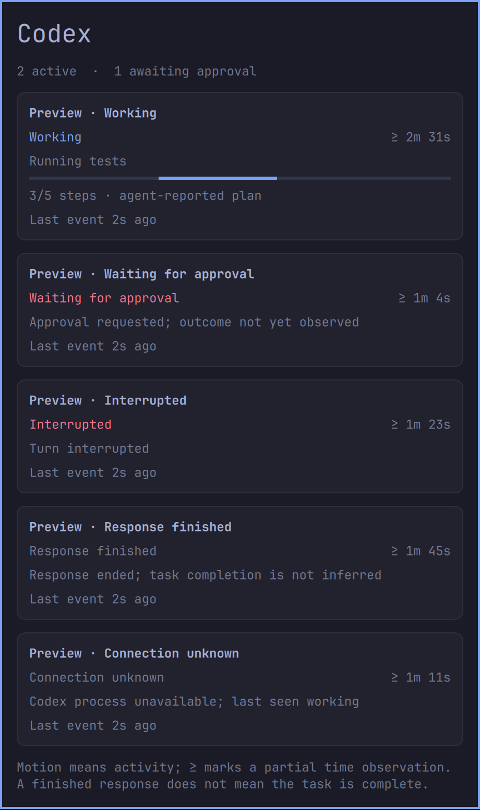

# Agent Progress

[](https://github.com/31780/agent-progress/actions/workflows/tests.yml)
[](LICENSE)

Local activity monitoring for Codex chats. See what is working, waiting for approval, interrupted, or finished responding—without invented completion percentages.

**Current support: Omarchy on Linux.** This is an early, working implementation. Other Linux desktops, macOS, and Windows are on the [portability roadmap](docs/ROADMAP.md); they are not supported yet. This is an independent community project, not an official OpenAI or Omarchy product.



*Simulated preview using the installed Omarchy theme. The regular popup scrolls; this taller preview shows every state.*

## Features

- Compact bar indicator and a popup with one entry per observed chat.
- Actual chat titles, generic tool activity, elapsed time and last-event age.
- Separate working, approval, interrupted, response-finished and unknown states.
- Animated activity bars when the amount of work is unknown.
- Explicit agent-reported milestones, such as `3/5 steps`.
- Local records, concurrent writers, conservative restart handling and reversible installation.

**A finished response does not mean the task is complete.** Step counts describe an agent's declared plan; they do not become an automatic completion estimate.

## Requirements

- Linux with Omarchy's Quickshell plugin system and an active Omarchy shell.
- Python **3.11+**, Git, and the `omarchy`/`omarchy-shell` commands.
- Codex with the lifecycle hooks listed below and the app-server metadata interface.

Tested on Omarchy 4.0.6-1, Quickshell 0.3.2.r7.g2b4501a-1, Codex CLI 0.163.0 and desktop runtime 0.163.0-alpha.10.2. Older versions have not been verified. No additional Python packages are required.

## Install

```sh
git clone https://github.com/31780/agent-progress.git
cd agent-progress
python3 install.py install
```

The installer backs up existing hook and bar configuration, adds only this project's handlers, installs user-owned files and enables the widget. It preserves your bar's position and other widgets. It does not modify `/usr/share/omarchy/` or Codex's `config.toml`.

Then open Codex CLI and run **`/hooks`**. Review and trust the ten entries labeled **Update Codex progress panel**. Codex skips untrusted definitions. Changed definitions require review again. See [the official hook documentation](https://learn.chatgpt.com/docs/hooks).

Click **◈** in your bar. Its number counts recently observed working or approval states. `!` indicates an approval request; `?` indicates unknown state. Chats appear after their next supported hook event. If observation begins mid-turn, `≥` marks elapsed time as a lower bound.

For title lookup, the helper prefers the Omarchy bundled Codex runtime, then `codex` on PATH. To select another installed executable, make `CODEX_PROGRESS_CODEX_BIN` available in the environment inherited by your desktop session. This changes executable discovery; it does not add support for another OS.

## States and limitations

| State | Evidence |
| --- | --- |
| Working | Prompt, tool, or compaction hook |
| Waiting for approval | PermissionRequest; outcome has not yet been observed |
| Interrupted | Interrupt hook |
| Response finished | Stop hook; task completion is not inferred |
| Connection unknown | Owner process disappeared/changed, session ended without a final event, or three minutes passed without a hook |
| Ready | Session opened; no turn observed yet |

There is no separate approval-resolved hook in the supported interface. Matching tool output or a later lifecycle transition clears the approval state. An accepted approval can still look like a wait while its command runs; a declined request is cleared by a subsequent Stop, interruption, or new turn if no tool output arrives.

Three minutes without a hook becomes unknown even if Codex is still reasoning or running a long tool. Hosted tools may not emit the local tool hooks. Unknown means insufficient evidence, not failure or task completion. Existing session history is not reconstructed. Subagent grouping is not implemented.

## Update or remove

```sh
# From your clone:
git pull --ff-only
python3 install.py install

# To remove the widget and its hook handlers:
python3 install.py remove
```

Removal retains local records and configuration backups. It removes only this project's hook handlers and widget, leaving unrelated hooks/settings intact. Installed files are moved into the backup directory.

The default branch is `master`. If you cloned the initial `main` branch, switch before updating:

```sh
git branch -m main master
git fetch origin
git branch --set-upstream-to=origin/master master
git remote set-head origin -a
```

| Location | Purpose |
| --- | --- |
| `~/.local/share/omarchy-agent-progress/` | Installed helper and installation receipt |
| `~/.config/omarchy/plugins/nino.codex-progress/` | Omarchy widget; the original plugin ID is retained for compatibility |
| `~/.codex/hooks.json` | Merged observer hooks |
| `~/.local/state/omarchy-agent-progress/` | Private records and configuration backups |

The installer honors XDG directory variables and `CODEX_HOME`. `OMARCHY_PROGRESS_STATE` overrides record storage for tests.

## Privacy and behavior

The observer stores titles, workspace paths, generic activity, timestamps, process identity, milestones and hashed tool-matching keys. It discards prompts, command bodies, tool output, transcript paths and assistant replies. Raw transcript parsing is not used. Records and backups stay local; this project adds no telemetry or upload endpoint. Titles use Codex's documented `thread/read` metadata interface with `includeTurns: false`.

Hooks run synchronously with a one-second timeout and return `{}`. They never approve, deny, block, or continue a Codex action. Storage/input failures fail open. The panel polls every two seconds; titles refresh approximately once per minute and on opening. Terminal entries display for one day, other records for seven days; reads filter expiry and hook writes perform cleanup. Snapshots contain at most 200 entries.

## Milestones

The observer accepts explicit plan statuses from `PostToolUse` events for `update_plan`. Agents can also report steps for an already observed session and current turn:

```sh
python3 src/progress.py report --session SESSION_ID --turn TURN_ID --done 3 --total 5
```

Unknown sessions, mismatched turns and invalid counts are rejected. Reports neither change lifecycle status nor refresh liveness. A new turn resets the plan. No global agent instructions are installed.

## Development

```sh
python3 -m unittest discover -s tests -v
omarchy plugin validate plugin
```

The unit suite runs without Codex or Omarchy on Linux. The manifest validation requires Omarchy. GitHub Actions runs the unit suite on Python 3.11 and 3.14.

For local end-to-end checks, install this revision and trust its hooks first:

```sh
python3 tests/runtime_check.py
```

This check uses the actual Codex app-server with an isolated state directory and a loopback-only model fixture. It exercises simultaneous sessions, an approval request and decline, interruption, abrupt process loss, and restart. It never accepts an escalation, bypasses hook trust or uses a remote model. It disables plugins/apps and standalone MCP servers declared in the user config; use a controlled local test setup if you have additional managed/project configuration. Runtime logs are kept in ignored `work/`, not committed.

The [architecture and portability roadmap](docs/ROADMAP.md) describes how to separate state logic, agent event sources, OS-specific liveness and desktop interfaces. See [CONTRIBUTING.md](CONTRIBUTING.md) before proposing a new interface or integration. DOT and ChatGPT integrations remain deferred until the Codex path is established.

## License and references

[MIT](LICENSE). Omarchy, Quickshell and Codex remain separate projects under their own licenses.

- [Official Codex hooks](https://learn.chatgpt.com/docs/hooks)
- [Official Codex app-server interface](https://learn.chatgpt.com/docs/app-server)
- Omarchy's installed plugin contract: `/usr/share/omarchy/shell/README.md` (read only)

## Join in

First-time contributors are welcome. Documentation, reproducible bug reports, accessibility improvements and regression tests are useful contributions; you do not need an Omarchy desktop to improve the docs or run the unit suite on Linux.

- [Contribution guide](CONTRIBUTING.md): fork, create a branch and open a pull request against `master`.
- [Report a bug or suggest a feature](https://github.com/31780/agent-progress/issues/new/choose).
- [Discussions](https://github.com/31780/agent-progress/discussions): questions and early ideas.
- [Community guidelines](CODE_OF_CONDUCT.md) and [private security reporting](SECURITY.md).

`master` requires pull requests, passing tests and resolved review conversations. Force-pushes and deletion are disabled. Contributors retain authorship; contributions use the MIT license, with no separate contributor agreement or commit-signing requirement.
