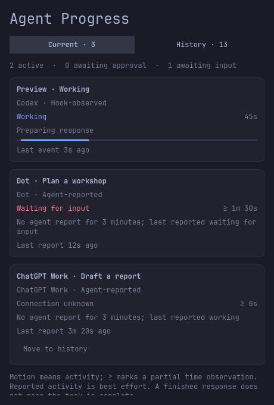

# Dot and ChatGPT Work: experimental reports

Agent Progress can display explicit reports from Dot and ChatGPT Work when those
agents can run tools on the computer hosting the panel. This is **best-effort
agent reporting**, not automatic monitoring of every chat. The panel marks each
card with its source and **Agent-reported**. Codex cards remain **Hook-observed**.



*Simulated cards rendered from the panel's QML content in an expanded preview.*

## What is supported

| Source | Integration | Limits |
| --- | --- | --- |
| Codex | Trusted lifecycle hooks and metadata API | Existing tested integration |
| Local-only Work using the Codex runtime | Existing runtime hooks where supported | Currently labeled Codex; no product identity is guessed from a model name |
| Dot with connected computer access | Optional reporting skill | Agent must use the skill and the computer hosting the panel |
| ChatGPT Work with local tools | Optional reporting skill | Same requirement; tool/skill availability depends on the account and environment |
| Ordinary Chat or cloud-only work | No direct integration | Cannot reach the local panel |

The local reporter and panel path are tested with isolated fixtures. A real Dot
or ChatGPT Work task has **not yet been verified end to end**. Do not describe the
experimental paths as full lifecycle support.

OpenAI documents local hooks for Codex and local-only Work. Cloud-orchestrated
Work and dots use enterprise-managed remote MCP hooks where enabled; personal
accounts do not use those enterprise hooks. Local configuration and plugin hooks
do not apply to cloud orchestration. See [Hooks](https://learn.chatgpt.com/docs/hooks#managed-hooks-from-requirementstoml).
Dots can use local skills with a connected computer; see
[Meet dots](https://learn.chatgpt.com/docs/dots). No undocumented endpoint,
private transcript, browser scraping, app database or credential extraction is
used by this project.

## Install and use

From the repository on the computer hosting the panel:

```sh
python3 install.py install --with-reporting-skill
```

This installs `agent-progress` under `$CODEX_HOME/skills` (normally
`~/.codex/skills`). Later panel updates preserve the selection. It adds no
cloud service, network listener or new hook definitions. Open a task that can
discover local skills and access this computer, then ask:

> Use the agent-progress skill to show this task in my Agent Progress panel.

The agent runs the skill's reporter as it makes progress. Merely installing a
skill does not guarantee invocation, and it does not attach to existing tasks.
If the skill is not available, or the agent only has cloud tools, this integration
cannot update the desktop. Don't copy the reporter into a cloud container and
expect it to reach your computer.

- **Working:** a recent explicit report of activity.
- **Waiting for input:** the agent says it needs your answer; this is separate
  from a Codex approval request.
- **Ready for review:** the agent says its deliverable is ready; moves to History.
  This is not a captured response-finish event or verified task completion.
- **Connection unknown:** no report for three minutes. A closed app, interrupted
  agent, unavailable computer and quiet ongoing work cannot be distinguished by
  this adapter. Nothing is marked complete because reports stopped.

Unknown reports can be moved to History. A fresh accepted update returns them to
Current. Each source/session has one latest record, retained for seven days,
sharing the 200-record cap with Codex. An explicit new run replaces the previous
run for that source/session. Avoid sensitive titles; titles and numeric
milestones are stored locally. Reports do not collect prompts, commands, answers
or tool payloads. Any process running as your OS user can report activity, just
as it can write the local widget state; a run token prevents stale updates, not
hostile code running as you.

## Contributor interface

Send one JSON object (at most 8 KiB) on standard input to
`python3 src/progress.py observe`, or to the installed skill's `scripts/report.py`.
The skill wrapper requires an installed panel on the executing computer.

Start a new run:

```json
{"action":"begin","source":"dot","session":"stable-task-id","title":"Prepare review notes"}
```

The response contains `id`, `run`, `sequence: 0` and `status`. Use the returned
ID and run token on updates. Each sequence must be a larger positive integer.

```json
{"action":"update","id":"returned-id","run":"returned-run","sequence":1,"status":"working","milestone":{"done":1,"total":3}}
```

Only `dot` and `chatgpt` are accepted report sources. Only `working`,
`waiting_input` and `ready_for_review` are accepted report states. Milestones
must be integer counts with `0 <= done <= total <= 1000` and `total > 0`. Omit
`milestone` to retain it or use `null` to clear it. Extra fields are rejected.
Repeated/out-of-order sequences and old run tokens are rejected without changing
liveness or history. After `ready_for_review`, further updates are rejected;
use `begin` only for genuinely resumed work. A `begin` is an explicit reset,
not an idempotent retry. There is no auto-retry or heartbeat process.

The snapshot retains schema version 1 and adds `source`, `sourceLabel` and
`observation` per task, plus `inputWaiting` at the top level. Existing Codex
records default to `source: codex` and `observation: hook`; no migration is needed.
The `waiting` count continues to mean native approval requests only.

The report reducer does not depend on Linux process inspection. Its tests run
on Linux, macOS and Windows; this **does not** make the Omarchy UI, installer or
Codex process adapter portable. See the [roadmap](ROADMAP.md).

Future automatic adapters need a documented event/status contract, real
approval/interruption/disconnection checks and a verified local delivery path.
Enterprise hook delivery is a separate integration; it is not enabled by this
reporter or installer.
